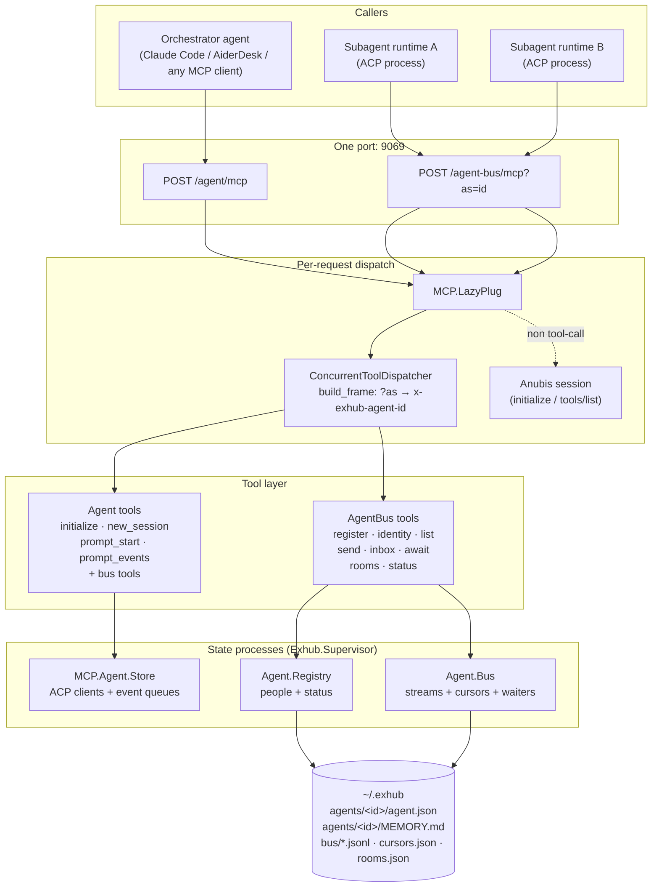
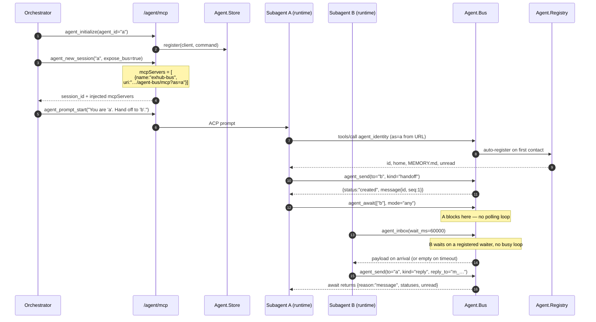
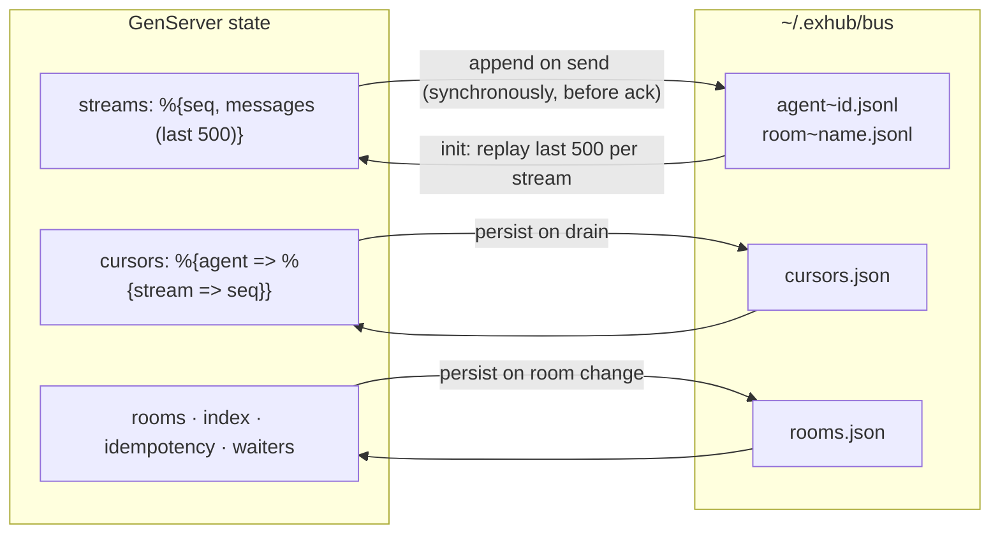
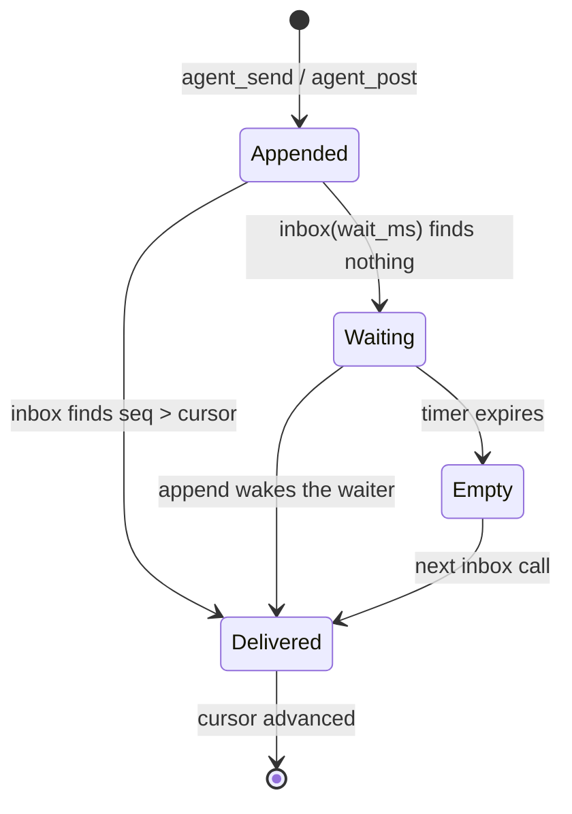
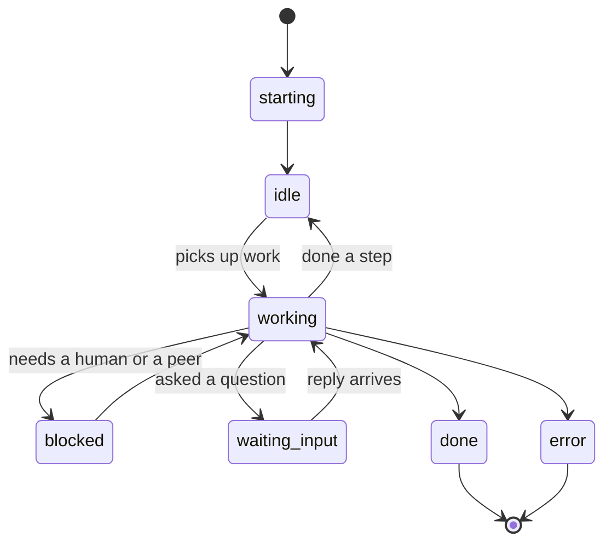

# Agent Bus

Agent-to-agent communication for ExHub: persistent participant identity, durable
direct messages, shared rooms, and fan-in waits. Mounted at `/agent-bus/mcp`.

The design was derived from the agent collaboration model in `~/code/raft-source`
(identity ≠ session, delivery by membership, attention on demand, claim before
work, evidence handoff). The full rationale and rejected alternatives are in
[`docs/plans/2026-11-02-agent-bus.md`](../plans/2026-11-02-agent-bus.md).

---

## Why it exists

`/agent/mcp` is a **star**: the orchestrator owns every `agent_id` and every
session, and a subagent can only be prompted by whoever spawned it. Two
consequences:

- peers cannot reach each other, so every inter-agent word is copied through the
  orchestrator's context window;
- `agent_prompt_events` is a pull loop over in-memory queues, so fan-in costs one
  poller per agent and a restart loses everything.

The bus adds the missing surface: **a name to address, a durable mailbox, and a
place to say something once**.

---

## Concepts

| Concept | Meaning |
| --- | --- |
| Participant | an agent **identity** (`~/.exhub/agents/<id>/agent.json` + `MEMORY.md`), independent of any session |
| Stream | `agent:<id>` (direct) or `room:<name>` (shared log) |
| Message | `id`, `stream`, `seq`, `from`, `to`, `kind`, `body`, `reply_to`, `idempotency_key`, `inserted_at` |
| Cursor | per `(agent, stream)` read position, server-side and persisted |
| Room | flat shared log; no ACLs, no nesting |

`kind` expresses intent, not transport:

- `ask` — needs an answer
- `tell` — information only
- `reply` — answers an `ask`; set `reply_to`
- `handoff` — work changes owner; include changed / where / evidence / uncertainty / next

---

## Tools

| Tool | Purpose |
| --- | --- |
| `agent_register` | create or update my record (idempotent upsert; partial updates allowed) |
| `agent_identity` | who am I: record, unread counts, joined rooms, `MEMORY.md` path |
| `agent_list` | participants with status, capabilities, live-process flag, unread |
| `agent_send` | direct message to one participant |
| `agent_inbox` | drain unread, long-poll with `wait_ms`, `peek` to inspect |
| `agent_await` | block until peers settle (idle/done/error/blocked/waiting_input) or reply |
| `agent_room_open` | create + join a room |
| `agent_post` | post to a room (creates and joins if needed) |
| `agent_room_history` | replay a room by `since_seq` |
| `agent_bus_status` | one snapshot: agents, unread, rooms, storage stats |

Identity resolution: explicit `as`, else the `x-exhub-agent-id` header injected
by `/agent-bus/mcp?as=<agent-id>`.

### Status vocabulary

`starting | idle | working | blocked | waiting_input | done | error | offline`,
plus `detail` (≤200 chars). `agent_set_status` writes both the ACP store and the
registry, so the ACP view and the bus view cannot disagree.

---

## Scoping

`/agent-bus/mcp` exposes **only** bus tools. A subagent handed this endpoint
cannot spawn agents, grant permissions, or shut anything down — the analogue of a
Raft agent's scoped credential.

`agent_new_session` with `expose_bus: true` injects:

```json
{"name": "exhub-bus", "uri": "http://127.0.0.1:9069/agent-bus/mcp?as=<agent_id>"}
```

HTTP MCP support varies by runtime. `mcp_servers` is passed through verbatim, so
a runtime that only speaks stdio can be given a bridge instead.

---

## Delivery semantics

- Every message is appended to `<home>/<stream>.jsonl` **before** the send is
  acknowledged.
- `seq` is per-stream and monotonic; `since_seq` replay is exact.
- Cursors are persisted; **delivery is at-least-once** — a crash between append
  and cursor write re-delivers rather than drops.
- The last 500 messages per stream stay in memory for `agent_room_history`;
  older messages remain on disk.
- Rooms and cursors live in `rooms.json` / `cursors.json` next to the streams.

Storage root: `~/.exhub/bus` (override with `config :exhub, :agent_bus_home`),
identity root: `~/.exhub/agents` (`config :exhub, :agent_home`).

---

## Worked examples

Coordinator spawns two peers and lets them talk:

```text
agent_initialize {"agent_id": "reviewer"}
agent_new_session {"agent_id": "reviewer", "cwd": "/repo", "expose_bus": true}
agent_prompt_start {"agent_id": "reviewer", "session_id": "s1",
                    "prompt": "Review the patch; use agent_inbox and agent_await. You are 'reviewer'."}

agent_initialize {"agent_id": "coder"}
agent_new_session {"agent_id": "coder", "cwd": "/repo", "expose_bus": true}
agent_prompt_start {"agent_id": "coder", "session_id": "s2",
                    "prompt": "Implement #42. Send your handoff to 'reviewer'."}
```

`coder` (inside its own runtime, no orchestrator in the loop):

```text
agent_send {"to": "reviewer", "kind": "handoff", "body": "..."}
```

`reviewer`:

```text
agent_inbox {"wait_ms": 60000}
agent_await {"agents": ["coder"], "mode": "any", "wait_ms": 60000}
```

Coordinator only checks the result:

```text
agent_bus_status {}
```

---

## What is deliberately not here

No channels-per-server, no scope matrix, no Socket.IO, no cron/reminders: this is
a single-user local hub. Tasks with claim locks, artifact handles and human action
cards are P2+ (see the plan document).

---

## Diagrams

### 1. Where the pieces sit



`/agent-bus/mcp` and `/agent/mcp` expose the same bus tools; the difference is
scope. A subagent gets `/agent-bus/mcp` (bus only); the orchestrator usually stays
on `/agent/mcp` (control + bus).

### 2. Cold start: spawn agents that can talk to each other



The orchestrator is out of the loop between steps 9 and 13 — that is the point of
the bus. It can still observe everything with `agent_bus_status`.

### 3. One send, inside the Bus GenServer

```mermaid
sequenceDiagram
  autonumber
  participant T as agent_send (tool)
  participant G as Agent.Bus GenServer
  participant W as pending agent_inbox waiter
  participant D as ~/.exhub/bus

  T->>G: call {:send, attrs}
  G->>G: validate from / to / body / kind / key
  alt idempotency_key already used
    G-->>T: {:ok, original_message, :replayed}
  else new message
    G->>G: seq = stream.seq + 1, id = "m_" <> hex
    G->>D: append &lt;stream&gt;.jsonl   (before ack)
    G->>G: update streams (last 500) · index · idempotency
    G->>G: recipient_agents(message)
    opt a waiter is registered for a recipient
      G->>G: drain(recipient) → advance + persist cursors
      G-->>W: GenServer.reply(payload)
    end
    G-->>T: {:ok, message, :created}
  end
```

### 4. Inbox: drain, cursor, or wait

```mermaid
sequenceDiagram
  autonumber
  participant T as agent_inbox (tool)
  participant G as Agent.Bus GenServer
  participant D as ~/.exhub/bus

  T->>G: call {:inbox, agent, wait_ms, limit, peek}
  G->>G: streams = agent:&lt;self&gt; + joined rooms
  G->>G: candidates = messages with seq > cursor
  alt candidates exist
    G->>G: sort by {inserted_at, stream, seq}, take limit
    G->>G: advance cursor per stream to the max delivered seq
    G->>D: cursors.json
    G-->>T: {messages, unread, cursors}
  else empty and wait_ms > 0
    G->>G: waiters[agent] += {from, ref, timer}
    G-->>G: {:noreply}
    Note over G: append wakes the waiter → reply<br/>or {:waiter_timeout, ref} → empty reply
  else empty and wait_ms == 0
    G-->>T: {messages: [], unread}
  end
```

### 5. What lives in memory vs on disk



Delivery is **at-least-once**: a crash between the JSONL append and the cursor
write re-delivers a message rather than losing it.

### 6. Message lifecycle



### 7. Participant status and what `agent_await` means by "settled"



`agent_await` treats `idle`, `done`, `error`, `offline`, `blocked` and
`waiting_input` as settled — the last two return early on purpose, because waiting
longer cannot help. A participant with no registry record and no live ACP process
counts as `not_running`, which is also settled.